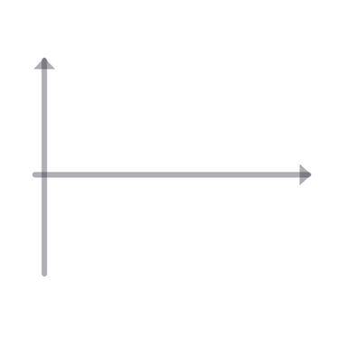
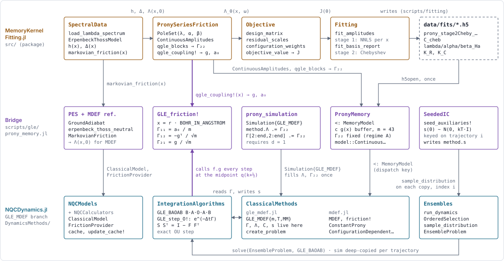
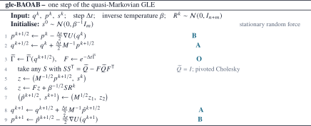

<div align="center">

  <picture>
    <source media="(prefers-color-scheme: dark)" srcset="./assets/logo-frameless-dark.gif" />
    <source media="(prefers-color-scheme: light)" srcset="./assets/logo-frameless.gif" />
    
  </picture>

</div>

<h1 align="center">MemoryKernelFitting.jl</h1>

<p align="center">
  <a href="https://github.com/Louhokseson/MemoryKernelFitting.jl/actions/workflows/CI.yml">
    
  </a>
  
  
  
  <a href="https://github.com/Louhokseson/MemoryElectronicFriction.jl">
    
  </a>
</p>

<div align="center">
  <h3>FDT-Safe Prony-Series Fits for Memory-Dependent Electronic Friction</h3>
</div>

---

<div align="justify">

<strong>MemoryKernelFitting.jl</strong> fits underdamped Prony-series memory kernels to
configuration-resolved spectral data. The resulting extended-variable stochastic
differential equation reproduces memory-dependent, configuration-dependent electronic
friction while preserving the fluctuation–dissipation structure required to sample the
correct Gibbs measure.

</div>

<div align="justify">

The input is a real-valued spectral density $\Lambda(x,\omega)$ on a configuration grid
$x$ and frequency window $\omega \in [0,\omega_{\max})$. The output is a compact set of
real and complex-conjugate modes from which the quasi-Markovian blocks
$\widetilde{\boldsymbol\Gamma}(x)$ and
$\widetilde{\boldsymbol\Sigma}(x)$ can be constructed.

</div>

```math
\begin{aligned}
\Lambda_\theta(x,\omega)
&= a_0(x)
 + \sum_{k=1}^{K_R} a_k(x)\frac{\lambda_k}{\lambda_k^2+\omega^2} \\
&\quad + \sum_{j=1}^{K_C} A_j(x)L(\omega;\alpha_j,\beta_j),
\end{aligned}
```

```math
\begin{aligned}
K(x,\tau)
&= 2a_0(x)\delta(\tau)
 + \sum_k a_k(x)e^{-\lambda_k\tau} \\
&\quad + \sum_j A_j(x)e^{-\alpha_j\tau}\cos(\beta_j\tau).
\end{aligned}
```

## Features

<div align="left">

| **Component** | **Description** |
|---------------|-----------------|
| **Spectral model** | Zero-frequency white part, overdamped Lorentzians, and mirrored underdamped Lorentzian pairs through <code>spectral_density</code> |
| **Time-domain kernel** | Matching exponential and damped-oscillatory Prony series through <code>memory_kernel</code> |
| **Basis functions** | <code>lorentzian</code> and <code>mirrored_lorentzian</code>, implemented as an explicit one-sided cosine-transform pair |
| **Resonant modes** | Real $2\times2$ rotation blocks for complex-conjugate poles $\alpha\pm i\beta$, allowing peaks at nonzero frequency |
| **FDT-safe parameterisation** | Non-negative amplitudes represented structurally as squares, with stable positive decay rates |
| **Pole ladders** | Log-spaced and uniform fixed ladders with the identifiability box of the frequency window, through <code>log_ladder</code> and <code>uniform_ladder</code> |
| **Configuration dependence** | <code>GridAmplitudes</code> for the convex stage, plus polynomial and warped-Chebyshev bases for the smooth stage, behind one <code>AmplitudeModel</code> interface |
| **QGLE readout** | Extended-variable blocks and the closed-form block exponential through <code>qgle_blocks</code> and <code>exp_gamma22</code> |
| **Spectral data** | Atomic-unit loading of the configuration-resolved spectra, graded-grid quadrature weights, and logarithmic frequency subsampling |
| **Validation** | Tests for symmetry, resonance onset, Markovian limits, dimension checks, numerical kernel–spectrum consistency, and fluctuation–dissipation structure |
| **Fitting pipeline** | Weighted objective, fixed-ladder per-configuration NNLS, and the stage-2 basis compression; the $\mu$-coupled roughness solve is available in the objective but not yet exercised, as production runs use $\mu=0$ |

</div>

## Installation

<div align="left">

**Prerequisites:** Julia ≥ 1.10
([download](https://julialang.org/downloads/)). The package is in early development and
is not yet registered in the Julia General registry.

**Setup:**

```julia
julia> using Pkg
julia> Pkg.develop(url="https://github.com/Louhokseson/MemoryKernelFitting.jl")
julia> Pkg.test("MemoryKernelFitting")
```

For local development from a clone:

```bash
julia --project=. -e 'using Pkg; Pkg.instantiate(); Pkg.test()'
```

</div>

## Quick Start

<div align="left">

```julia
using MemoryKernelFitting

a₀ = 0.0                                      # white / instantaneous part
a, λ = [0.75], [10.0]                         # overdamped modes
A, α, β = [1.5, 0.4], [0.5, 1.2], [3.0, 7.0] # underdamped pairs

Λω = spectral_density(3.0, a₀, a, λ, A, α, β)
Kτ = memory_kernel(0.2, a, λ, A, α, β)

# Markovian anchor: the zero-frequency friction used by standard MDEF
Λ₀ = spectral_density(0.0, a₀, a, λ, A, α, β)
```

The white contribution $2a_0\delta(\tau)$ is intentionally excluded from
<code>memory_kernel</code>; it enters the dynamics as instantaneous friction rather
than through the regular memory convolution.

</div>

## Development Status

<div align="justify">

The model, data, objective, and both fitting stages are implemented and tested:
spectral and time-domain evaluation, the two basis functions, pole ladders, the three
configuration-dependent amplitude representations, QGLE readout, atomic-unit spectral
data loading, the weighted objective, independent per-configuration NNLS for stage 1,
and the basis compression of stage 2. The continuous readout evaluates a stage-2 fit at
arbitrary $x$, which is what [From Fit to Dynamics](#from-fit-to-dynamics) runs on.

</div>

<div align="justify">

The remaining fitting work is the $\mu$-coupled roughness solve: the penalty is
implemented in the objective, but production fits run at $\mu=0$, with the columns
decoupled. Outer variable projection is implemented as an optional pole diagnostic
rather than as part of the fixed-ladder production path.

Design decisions with lasting consequences are recorded in
<a href="docs/design/"><code>docs/design/</code></a>, and progress is logged in
<a href="docs/DEVLOG.md"><code>docs/DEVLOG.md</code></a>.

</div>

## Repository Layout

<div align="left">

| Path | Contents |
|------|----------|
| [<code>src/</code>](src) | Package implementation and public model-evaluation API |
| [<code>test/</code>](test) | Unit and numerical cosine-transform consistency tests |
| [<code>scripts/</code>](scripts) | Fitting drivers, and the NQCDynamics adapter and GLE runs in [<code>scripts/gle/</code>](scripts/gle) |
| [<code>docs/PronySeries/</code>](docs/PronySeries) | QGLE derivation, optimisation problem, and theory handover notes |
| [<code>assets/</code>](assets) | Static and animated package logos plus the animation generator |
| [<code>data/</code>](data) | Local spectral and simulation data; large outputs are not tracked |
| [<code>plots/</code>](plots) | Generated visualisations and fitting diagnostics |
| [<code>notebooks/</code>](notebooks) | Exploratory analysis notebooks |

</div>

## The Fitting Model

The mirrored underdamped basis is

```math
\begin{aligned}
L(\omega;\alpha,\beta)
&= \frac{\alpha}{2}
\left[
\frac{1}{\alpha^2+(\omega-\beta)^2}
+ \frac{1}{\alpha^2+(\omega+\beta)^2}
\right], \\
a_0,\,a_k,\,A_j &\ge 0.
\end{aligned}
```

<div align="justify">

<strong>The underdamped pairs are mandatory, not a refinement.</strong>
The target spectra are not monotone in $\omega$: they carry a resonance at
$\omega_{\mathrm{pk}}\approx1.02$–$1.15\,|h(x)|$ that sweeps from zero up to
$9.4\,\mathrm{eV}$ as the electronic level crosses the Fermi energy. A sum of
zero-centred Lorentzians is strictly decreasing and cannot produce such a peak;
complex-conjugate pole pairs can.

</div>

<div align="justify">

The mirror in $L$ follows from realness rather than modelling preference.
Because $\boldsymbol\Gamma_{2,2}$ is real, its complex eigenvalues
$\alpha\pm i\beta$ occur in conjugate pairs and generate Lorentzians at
$\omega=\pm\beta$ with half-width $\alpha$. The pair is a genuine resonance when
$\beta>\alpha/\sqrt{3}$; below that threshold it merges continuously into a monotone,
zero-centred response.

</div>

### FDT-Safe Construction

Set $m=K_R+2K_C$ and retain real rotation blocks:

```math
\begin{aligned}
\boldsymbol\Gamma_{2,2}
&= \mathrm{blockdiag}
\left(
\lambda_1,\ldots,\lambda_{K_R},
R(\alpha_1,\beta_1),\ldots
\right), \\
R(\alpha,\beta)
&=
\begin{pmatrix}
\alpha & \beta\\
-\beta & \alpha
\end{pmatrix}.
\end{aligned}
```

```math
\begin{aligned}
\widetilde{\boldsymbol\Gamma}_{1,1}(x)
&=a_0(x), \\
\boldsymbol g(x)
&=
\left(
\sqrt{a_1},\ldots,\sqrt{A_1},0,\ldots
\right)^T, \\
\widetilde{\boldsymbol\Gamma}_{2,1}
&=\boldsymbol g,
\qquad
\widetilde{\boldsymbol\Gamma}_{1,2}=-\boldsymbol g^T.
\end{aligned}
```

Two structural consequences make the fit well posed:

- **Amplitudes are squares.** The fluctuation–dissipation theorem reduces the coupling
  to one fitted function $\boldsymbol g(x)$ and enforces non-negative $a_k$ and $A_j$.
  A negative fitted amplitude is therefore a hard signal that no Gibbs-consistent
  QGLE within this ansatz reproduces the data.
- **$\boldsymbol Q=\boldsymbol I$ survives.**
  Each real rotation block gives
  $\boldsymbol g^T e^{-\tau R}\boldsymbol g
  =|\boldsymbol g|^2e^{-\alpha\tau}\cos(\beta\tau)$ and
  $R+R^T=2\alpha\boldsymbol I$, so
  $\widetilde{\boldsymbol\Sigma}_2=\sqrt{2\alpha}\,\boldsymbol I_2$.
  The stability requirement is
  $\boldsymbol\Gamma_{2,2}\boldsymbol Q
  +\boldsymbol Q\boldsymbol\Gamma_{2,2}^T\succ0$, not symmetry of the drift matrix.

### Fitting Strategy

<div align="justify">

The model is linear in the amplitudes and nonlinear only in the poles, so variable
projection separates the optimisation into an inner convex non-negative least-squares
problem and an outer low-dimensional pole search. Relative residual weights are needed
because $\Lambda$ spans approximately $10^{-12}$ to $10^4$; configuration-space
quadrature weights correct a grid where 83% of the columns cover only 6.7% of the
range; and roughness regularisation prevents near-degenerate poles from exchanging
amplitude arbitrarily.

</div>

<div align="justify">

Rates are shared across configurations while amplitudes vary with $x$. This is the
regime in which the two-time path-ordered kernel collapses exactly to a Prony series in
the lag. Allowing poles to track $x$ instead is an adiabatic approximation that fails
most strongly near the crossing, where
$\tau_{\mathrm{mem}}/\tau_{\mathrm{conf}}\approx34$ even at 300 K. A tiling argument
gives $K_C=30$ pairs ($m=60$), but the measured fixed-ladder fit plateaus near
$K_C\approx10$ ($m=20$); the final ladder should therefore be chosen from measured
accuracy and integration cost rather than the tiling estimate alone. Once the ladder is
fixed, the outer search disappears and the amplitude fit is a convex NNLS problem with
a global optimum.

</div>

## From Fit to Dynamics

<div align="justify">

Fitting ends with one HDF5 file: the shared pole ladder $(\lambda,\alpha,\beta)$ and the
Chebyshev coefficients of $\boldsymbol g(x)$. Running dynamics with it is
[NQCDynamics.jl](https://github.com/NQCD/NQCDynamics.jl)'s job. The two packages meet in a
single adapter, <code>scripts/gle/prony_memory.jl</code>, which is deliberately outside
<code>src/</code>: a fitting package has no business depending on an SDE integrator.
The adapter wraps the fit as a <code>PronyMemory &lt;: MemoryModel</code>, and everything
after that is stock <code>run_dynamics</code>.

</div>

<div align="center">

  <picture>
    <source media="(prefers-color-scheme: dark)" srcset="./assets/module-map-dark.svg" />
    <source media="(prefers-color-scheme: light)" srcset="./assets/module-map.svg" />
    
  </picture>

</div>

<div align="justify">

Only two modules are live at run time. <code>SpectralData</code> supplies the analytic
envelope $\sqrt{\Lambda(x,0)}$ and the warp $t(x)$, and
<code>PronySeriesFriction</code> evaluates the Chebyshev readout. The violet path is the
only work done per step: the integrator asks for the friction at the half-step position,
and <code>qgle_coupling!</code> rebuilds $\boldsymbol g(x)$ into the drift matrix. In
regime (A) the poles are shared across configurations, so
$\boldsymbol\Gamma_{2,2}$ and $\widetilde{\boldsymbol\Sigma}_2$ are built once and never
touched again — which is precisely why the realised kernel is exactly the fitted one.

</div>

### The gle-BAOAB Integrator

<div align="justify">

The extended system is integrated by the Hamiltonian–Ornstein–Uhlenbeck splitting of
Sachs: the force (B) and drift (A) half-steps surround an <strong>exact</strong>
Ornstein–Uhlenbeck step (O) for the linear part at frozen configuration. Writing
$n$ physical degrees of freedom, $m$ auxiliary variables and
$\boldsymbol R^k\sim\mathcal{N}(0,\boldsymbol I_{n+m})$, one step of
$(q^k,p^k,s^k)\mapsto(q^{k+1},p^{k+1},s^{k+1})$ is

</div>

<div align="center">

  <picture>
    <source media="(prefers-color-scheme: dark)" srcset="./assets/gle-baoab-dark.svg" />
    <source media="(prefers-color-scheme: light)" srcset="./assets/gle-baoab.svg" />
    
  </picture>

</div>

<details>
<summary>The same step as LaTeX</summary>

```math
\begin{aligned}
\textbf{B}\quad
& p^{k+1/2} = p^k - \tfrac{\Delta t}{2}\nabla U(q^k), \\
\textbf{A}\quad
& q^{k+1/2} = q^k + \tfrac{\Delta t}{2}\boldsymbol M^{-1}p^{k+1/2}, \\
\textbf{O}\quad
& \widetilde{\boldsymbol\Gamma}
 = \widetilde{\boldsymbol\Gamma}(q^{k+1/2}), \qquad
\boldsymbol F = e^{-\Delta t\widetilde{\boldsymbol\Gamma}}, \qquad
\boldsymbol S\boldsymbol S^T
 = \widetilde{\boldsymbol Q}
 - \boldsymbol F\widetilde{\boldsymbol Q}\boldsymbol F^T, \\
& \boldsymbol z = \left(\boldsymbol M^{-1/2}p^{k+1/2},\, s^k\right), \qquad
\boldsymbol z \leftarrow
 \boldsymbol F\boldsymbol z + \beta^{-1/2}\boldsymbol S\boldsymbol R^k, \\
& \left(\hat p^{k+1/2},\, s^{k+1}\right)
 = \left(\boldsymbol M^{1/2}\boldsymbol z_1,\, \boldsymbol z_2\right), \\
\textbf{A}\quad
& q^{k+1} = q^{k+1/2}
 + \tfrac{\Delta t}{2}\boldsymbol M^{-1}\hat p^{k+1/2}, \\
\textbf{B}\quad
& p^{k+1} = \hat p^{k+1/2} - \tfrac{\Delta t}{2}\nabla U(q^{k+1}),
\end{aligned}
```

The figure is typeset from [<code>assets/gle_baoab_algorithm.tex</code>](assets/gle_baoab_algorithm.tex);
rebuild both themes with [<code>assets/build_algorithm.sh</code>](assets/build_algorithm.sh).

</details>

<div align="justify">

With $\widetilde{\boldsymbol Q}=\boldsymbol I$ the noise factor is any $\boldsymbol S$ with
$\boldsymbol S\boldsymbol S^T=\boldsymbol I-\boldsymbol F\boldsymbol F^T$. That covariance
can be positive <em>semi</em>-definite rather than definite — without a white part $a_0$,
noise reaches the momenta only through the coupling, and then at order $\Delta t^{3/2}$ —
so a pivoted Cholesky factorisation, truncated at the numerical rank, is the right tool.

</div>

<div align="justify">

Three properties matter for this package. The O-step is the exact solution of the linear
SDE, so it is unconditionally stable and $\Delta t$ is limited by the A/B part alone. Each
sub-map preserves the extended Gibbs measure, and the symmetric composition is second-order
accurate for ergodic averages. And in the white-noise limit the scheme reduces to BAOAB for
Langevin dynamics with friction $\Lambda(x,0)$ — the consistency requirement that ties the
fitted GLE back to standard MDEF, and the reason
<code>markovian_friction</code> is anchored into the objective.

</div>

<div align="justify">

<strong>Two conventions</strong> are worth stating, because the scheme is written above
with the mass matrix restored. Sachs sets $\boldsymbol M=\boldsymbol I$ throughout §4.1,
so the mass weighting here follows the flow maps rather than the printed algorithm: the
O-step acts on $\boldsymbol z=(\boldsymbol M^{-1/2}p, s)$, and the noise carries the
$\beta^{-1/2}$ of the exact OU step. This package writes the QGLE with unweighted momenta,
so the adapter applies $1/\sqrt{m}$ to the coupling and $1/m$ to the white part exactly
once, when it fills $\widetilde{\boldsymbol\Gamma}$.

</div>

<div align="left">

| Piece of the step | Where it lives |
|---|---|
| $\widetilde{\boldsymbol\Gamma}$, $\widetilde{\boldsymbol\Sigma}_2$ from a fit | <code>qgle_blocks</code>, <code>gamma_matrix</code> (this package) |
| $e^{-\Delta t\boldsymbol\Gamma_{2,2}}$ in closed form | <code>exp_gamma22</code> (this package) |
| $\boldsymbol g(x)$ per step, allocation-free | <code>qgle_coupling!</code> (this package) |
| B, A, O composition and the pivoted Cholesky | <code>GLE_BAOAB</code>, <code>GLE_step_O!</code> (NQCDynamics.jl) |

</div>

<div align="justify">

The algorithm is scheme (B.1) of Sachs' thesis, assembled from the H–OU splitting of §4.1
with the exact Ornstein–Uhlenbeck step of Eq. (4.7); §4.7 covers the configuration-dependent
case, where the matrix exponential and the factorisation must be recomputed each step. The
configuration-dependent QGLE it integrates, and the fluctuation–dissipation condition that
makes the extended Gibbs measure invariant, are Eq. (20) and Eqs. (34)–(35) of Leimkuhler
and Sachs (2019). The block conventions follow
[GLEFrictionFit.jl](https://github.com/MatthiasSachs/GLEFrictionFit.jl).

</div>

## Documentation

The detailed theory and optimisation specification live in
[<code>docs/PronySeries/</code>](docs/PronySeries):

| File | Contents |
|------|----------|
| <code>Prony series (corrected).md</code> | Canonical QGLE derivation, two-time kernel, and FDT pairing |
| <code>Prony_fit_optimisation_problem.md</code> | Full fitting objective, calibration, and underdamped-series construction |
| <code>HANDOVER.md</code> | Index and development handover |

## Citation

This package builds on the quasi-Markovian GLE and underdamped memory-kernel
constructions described in:

- Sachs, *PhD thesis* (University of Edinburgh, 2017): Eq. (3.7) and §4.7.2 for the kernel
  and the oscillatory realisation; §4.1 and Eq. (4.7) for the H–OU splitting and the exact
  Ornstein–Uhlenbeck step; Appendix B, scheme (B.1), for the gle-BAOAB algorithm.
- Leimkuhler and Sachs (2019), *Ergodic Properties of Quasi-Markovian Generalized Langevin
  Equations with Configuration Dependent Noise and Non-conservative Force*, Springer
  Proceedings in Mathematics & Statistics **282**,
  [doi:10.1007/978-3-030-15096-9_8](https://doi.org/10.1007/978-3-030-15096-9_8):
  Eq. (20) for the configuration-dependent QGLE, Eqs. (34)–(35) for the FDT pairing.
- Stella, Lorenz, and Kantorovich, *Physical Review B* **89**, 134303 (2014).
- Lei, Baker, and Li, *PNAS* **113**, 14183 (2016).

If you use <code>MemoryKernelFitting.jl</code> in published work, cite the relevant
theory above and this repository:

```bibtex
@software{MemoryKernelFitting_jl,
  author = {Lu, Xuexun},
  title  = {{MemoryKernelFitting.jl}: FDT-safe Prony-series fits for memory-dependent electronic friction},
  year   = {2026},
  url    = {https://github.com/Louhokseson/MemoryKernelFitting.jl}
}
```


## License

This project is licensed under the [MIT License](./LICENSE). See the full text for details.

---

<div align="center">

<br/>

[**Xuexun Lu (Hokseon)**](https://louhokseson.github.io)<br>
*PhD Candidate, The Maurer Computational Surface Science Group*<br>
The University of Warwick, UK

[](mailto:louhokseson@gmail.com)
[](https://orcid.org/0009-0004-4916-5970)
[](https://scholar.google.com/citations?user=233SExsAAAAJ&hl=en)

<br/>

</div>

<div align="center" style="font-size: 0.85em; color: #666; margin-top: 1em;">
Copyright © 2026 Xuexun Lu. Licensed under the MIT License.
</div>
